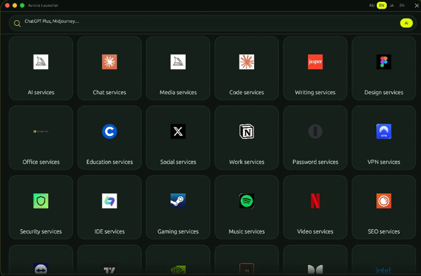

# Adobe Acrobat Pro Free 2026 — edit PDF, Acrobat Sign, redact

> **Adobe Acrobat is paid everywhere. In our Aivora launcher the same paid Pro version is free.**
>
> Official site / app store = paid Pro subscription. Aivora launcher = that paid Pro product, free on Windows 10 / 11.

**Keywords:** Adobe Acrobat Pro · Acrobat Pro free · Acrobat Pro windows · edit PDF · e-sign · paid Acrobat free through launcher · Aivora Programs

Windows 10 / 11 · Adobe Acrobat Pro · Office and cloud

The orange button opens [https://aivoraprograms.com/](https://aivoraprograms.com/). Install Aivora, then **Activate** **Adobe Acrobat**. You get the **paid Pro** product **for free in our launcher**. No `AdobeAcrobat.exe` in this repository.

## What Adobe Acrobat is

Adobe Acrobat Pro is the paid PDF desk: **edit text and images**, **Acrobat Sign**, compare files, **redact**. The Aivora card is **Pro**, not the free Acrobat Reader. This is not Creative Cloud All Apps (Photoshop / Premiere live on that tile).

**Adobe Acrobat is paid everywhere else.** Official access is a Pro subscription. In **our Aivora launcher** that same paid Pro is **free** on Windows 10 / 11. No vendor account. No credit card.

## edit PDF, Acrobat Sign, redact

Reader cannot edit. Sign is the e-sign extra. Redact is the legal extra. After **Activate**, open Acrobat from Office and cloud. This repo has no PDF of yours.

## Who this Windows page is for

Searches **Adobe Acrobat Pro**, **Acrobat windows**, **Acrobat Pro free** wanting **paid Pro**, not Reader.

## What the Pro card includes

| Feature | Official Adobe Acrobat | In our Aivora launcher |
|---------|--------------|------------------------|
| Price | Paid Pro subscription | **Free** (same paid Pro) |
| **Edit text and images in PDF** | Pro | Same paid Pro, free here |
| **Acrobat Sign** | Pro | Same paid Pro, free here |
| **Redact / compare** | Pro | Same paid Pro, free here |

## How to open paid Adobe Acrobat on Windows

1. Open [https://aivoraprograms.com/](https://aivoraprograms.com/)
2. Download **Aivora Launcher**
3. Install on **Windows 10** or **Windows 11** (64-bit)
4. Open **Office and cloud**
5. Find **Adobe Acrobat** and press **Activate**

Paid Adobe Acrobat Pro — **free in our launcher**, paid on the official site.

## Search queries this page covers

- **Adobe Acrobat Pro**
- **Acrobat Pro free**
- **Acrobat Pro windows**
- **edit PDF**
- **paid Acrobat free through launcher**

## Screenshots

Aivora launcher hub — **Office and cloud** → **Adobe Acrobat**:

## FAQ

**Is this Creative Cloud All Apps?**  
No. All Apps is a different Aivora card. This tile is Acrobat Pro only.

**Where is the download?**  
[https://aivoraprograms.com/](https://aivoraprograms.com/)

**Is Adobe Acrobat paid or free?**  
Paid everywhere (official Pro). **Free in our Aivora launcher** — same paid Pro version.

**Do I need a Adobe Acrobat account?**  
No. **Activate** on the tile.

---

## На русском

# Adobe Acrobat Pro бесплатно 2026 — правка PDF, Acrobat Sign, redact

> **Везде Adobe Acrobat платный. В нашем лаунчере Aivora та же платная версия Pro — бесплатно.**
>
> Официальный сайт / магазин = платная подписка Pro. Лаунчер Aivora = этот же платный Pro, бесплатно на Windows 10 / 11.

**Ключевые слова:** Adobe Acrobat Pro · Acrobat бесплатно · Acrobat Pro windows · правка PDF · подпись · платный Acrobat бесплатно через лаунчер · Aivora Programs

Оранжевая кнопка — главная Aivora. Лаунчер → **Офис и облако** → **Adobe Acrobat** → **Активировать**. Это **платный Pro**, у нас в лаунчере **бесплатно**.

Adobe Acrobat Pro — платный PDF: **правка текста и картинок**, **Acrobat Sign**, сравнение, **redact**. Карточка Aivora — **Pro**, не бесплатный Reader. Это не Creative Cloud All Apps.

**Adobe Acrobat везде платный.** Официально подписка Pro. **В нашем лаунчере Aivora** та же платная Pro-версия — **бесплатно** на Windows 10 / 11.

Reader не редактирует. Sign — подпись. Redact — вымарывание. Ваших PDF в git нет.

Запросы **Adobe Acrobat Pro**, **Acrobat бесплатно** — нужен **платный Pro**.

| Функция | Официально | В нашем лаунчере Aivora |
|---------|------------|-------------------------|
| Цена | Платная подписка Pro | **Бесплатно** (тот же Pro) |
| **Правка текста и картинок в PDF** | Pro | Та же платная Pro, у нас бесплатно |
| **Acrobat Sign** | Pro | Та же платная Pro, у нас бесплатно |
| **Redact / сравнение** | Pro | Та же платная Pro, у нас бесплатно |

Как открыть: [https://aivoraprograms.com/](https://aivoraprograms.com/) → лаунчер → **Офис и облако** → **Adobe Acrobat** → **Активировать**.

**Это Creative Cloud All Apps?**  
Нет. All Apps — другая карточка. Здесь только Acrobat Pro.

Adobe Acrobat — товарный знак Adobe Inc.. Страница описывает доступ через Aivora Programs.

[https://aivoraprograms.com](https://aivoraprograms.com/) · hello@aivora.app

#windows11 #windows10 #acrobat #pdf #aivora

---

*Adobe Acrobat Pro · Acrobat Pro free · Acrobat Pro windows · edit PDF · e-sign · paid Acrobat free through launcher · Aivora Programs · paid Adobe Acrobat free through launcher · Aivora Programs · https://aivoraprograms.com/programs/adobe-acrobat-pro/*
